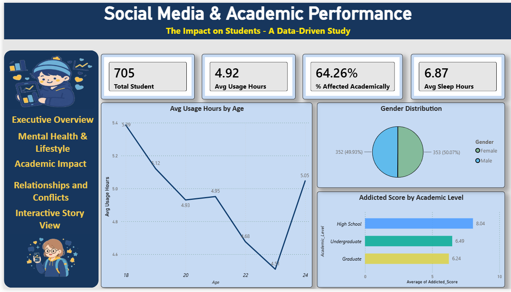
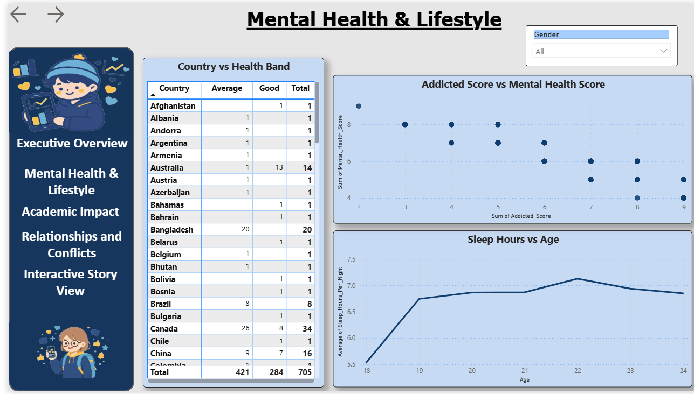
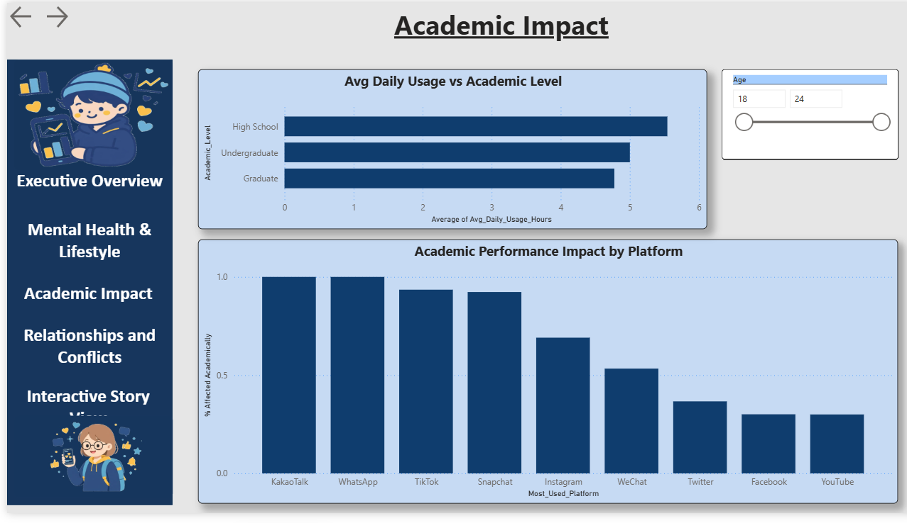
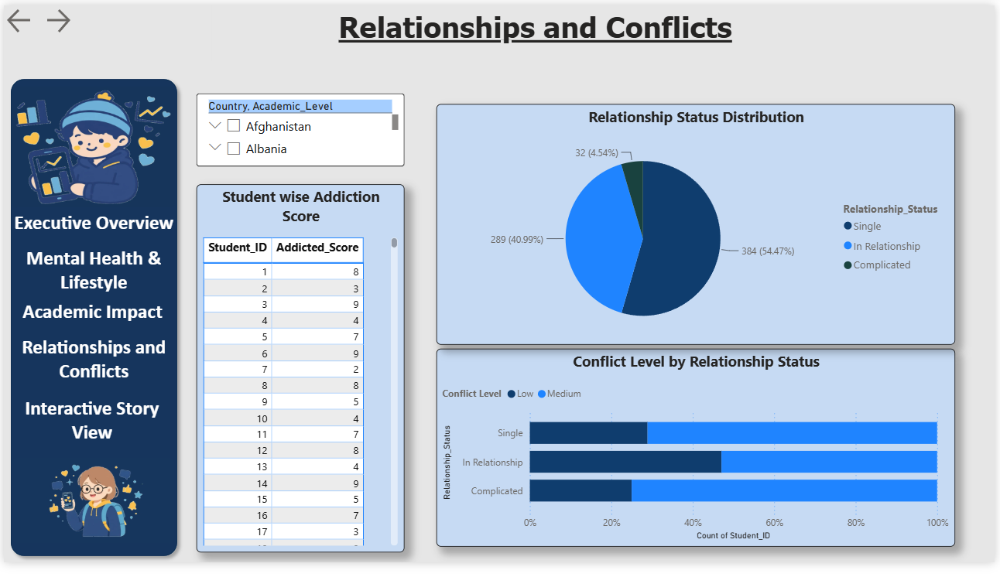
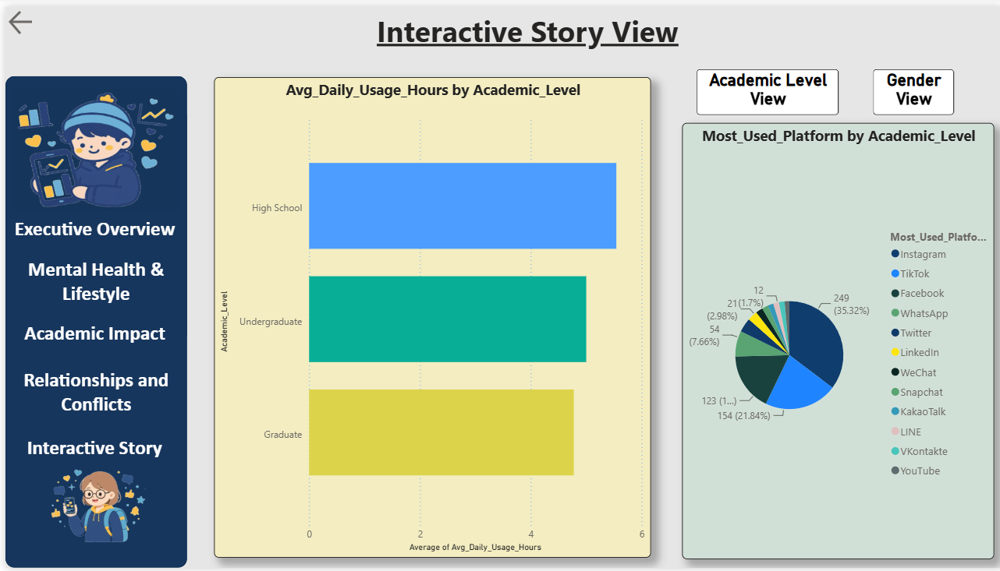
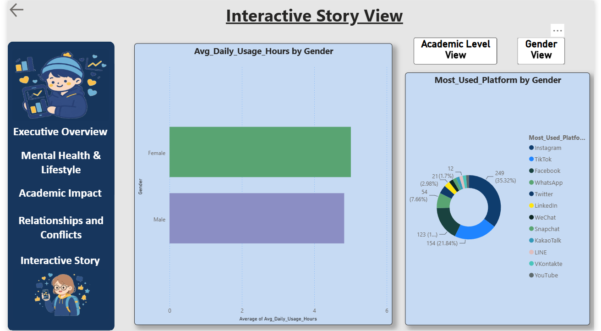

# Social-Media-Academic-Performance

Power BI dashboard analyzing social media impact on students' academic performance, mental health & lifestyle.

## 📊 Dashboard Overview

### 1. Executive Overview

### 2. Mental Health & Lifestyle

### 3. Academic Performance

### 4. Relationship & Conflict

### 5. Interactive Story - Academic View

### 6. Interactive Story - Gender View

## 📁 Files in this Repo
- `Social-Media-Academic-Performance.pbix` - Main Power BI File
- `Students-Social-Media-Data.xlsx` - Raw Data (Excel File)
- `1-Executive_overview.png` to `6-Interactiv_story_Gender_View.png` - Dashboard Pages Screenshots

## 📂 Data Source
- Raw data taken from Excel file
- Data cleaned & transformed using Power Query in Power BI
- Data modeling & measures created using DAX

## 🔍 Key Insights
- Excessive social media usage affects sleep, focus & academic performance.
- Students with balanced usage show better mental health & grades.
- Gender-wise and academic-wise patterns show clear differences in usage & impact.
- High screen time is linked with more conflicts and lower concentration.

## 🛠️ Tools Used
- Power BI Desktop
- Power Query
- DAX
- Microsoft Excel

## 👩‍💻 Author
**Sadhna Gangwar**
